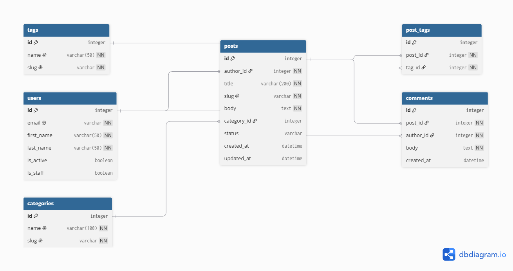
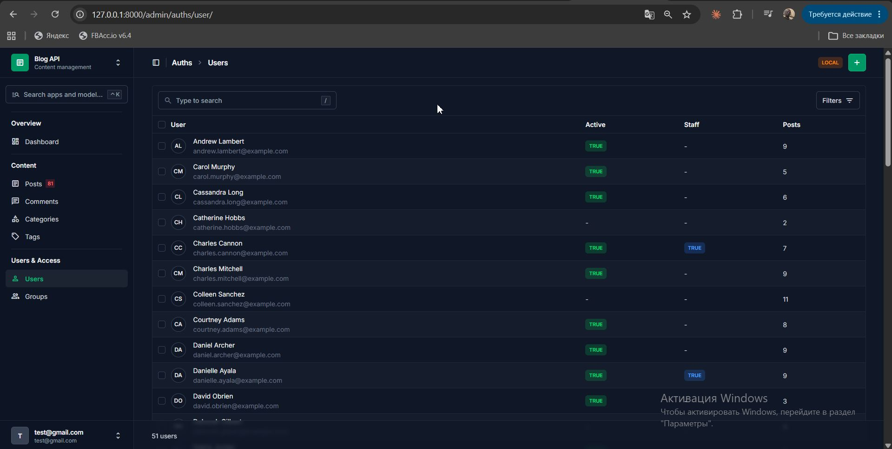

# Blog API

REST API for a blog built with Django REST Framework and JWT authentication.
The admin panel uses [Django Unfold](https://unfoldadmin.com/).

## ERD



## Setup

```bash
python -m venv venv
venv\Scripts\activate
pip install -r requirements/dev.txt
python manage.py migrate
python manage.py runserver
```

Create `settings/.env` with `BLOG_ENV_ID` and `BLOG_SECRET_KEY`.

## Seeding

The `seed` command fills the database with fake data: users, categories, tags, posts and comments.
It needs `Faker` from `requirements/dev.txt`.

```bash
python manage.py seed
```

| Argument     | Default | Description                                                  |
|--------------|---------|--------------------------------------------------------------|
| `--users`    | `20`    | Number of users to create                                    |
| `--posts`    | `100`   | Number of posts to create                                    |
| `--comments` | `500`   | Number of comments to create                                 |
| `--clear`    | off     | Delete existing data before seeding (superusers are kept)    |

Example:

```
$ python manage.py seed --users 50 --posts 300 --comments 1500
Users:       50 created
Categories:   8 created
Tags:        20 created
Posts:      300 created
Comments:  1500 created
Done in 0.84 seconds
```

Notes:

- All seeded users have the same password, stored in `SEED_PASSWORD` in `apps/blog/management/commands/seed.py`.
- About 70% of posts are published, comments are created only on published posts.
- Running the command twice does not fail: existing categories and tags are skipped, emails and slugs stay unique.
- Show all options: `python manage.py seed --help`.

## Admin

Open `http://127.0.0.1:8000/admin/` after creating a superuser.

On an empty database:

```bash
python manage.py migrate
python manage.py seed
python manage.py createsuperuser
python manage.py runserver
```

Features:

- **Dashboard**: cards (users, published posts, drafts, comments), posts per category chart, top 5 authors, published vs drafts progress bars.
- **Posts**: colored status labels, filters (status, category, tags, author, dates), search, expandable rows with comments, bulk and per-row publish actions, "Publish all drafts", "Save & publish", WYSIWYG editor, comments inline.
- **Comments**: filters with autocomplete and date range, search, no N+1 queries.
- **Users**: initials header, colored labels, radio filters, tabbed edit form, password change, Activate / Deactivate actions.
- **Categories and Tags**: auto slug, search, sortable posts counter.

### Screenshots

Dashboard:


Post list with filters:


Post edit page:


User list:

