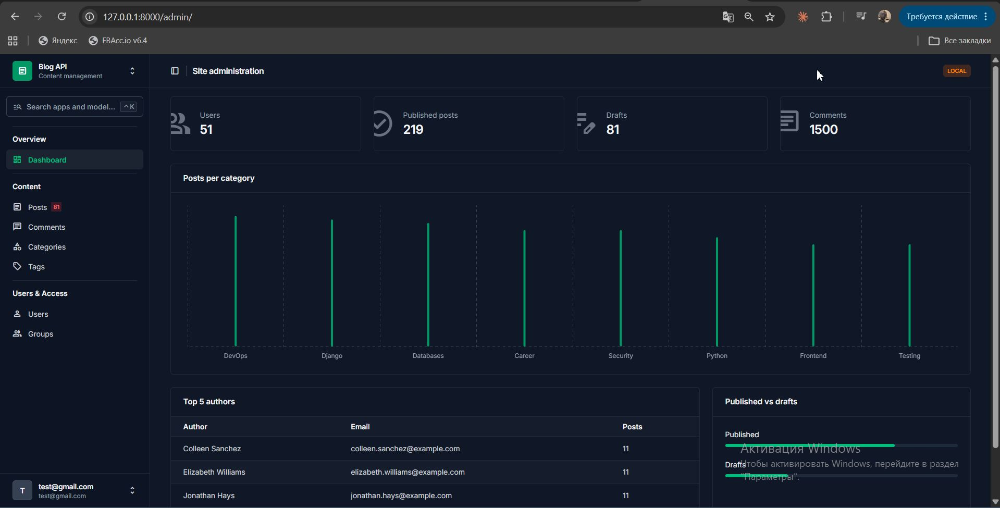
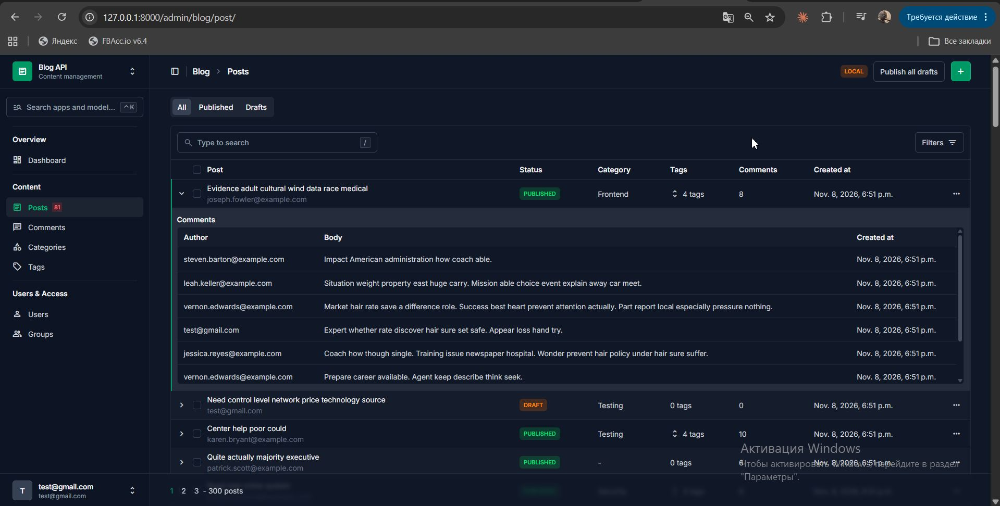
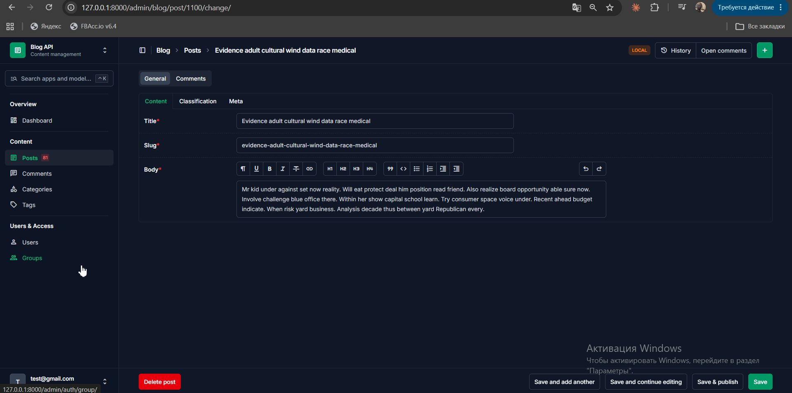

# Blog API

REST API for a blog built with Django REST Framework and JWT authentication.
The admin panel uses [Django Unfold](https://unfoldadmin.com/).

## ERD


## Setup

```bash
python -m venv venv
venv\Scripts\activate
pip install -r requirements/dev.txt
python manage.py migrate
python manage.py runserver
```

Create `settings/.env` with `BLOG_ENV_ID` and `BLOG_SECRET_KEY`.

## Seeding

The `seed` command fills the database with fake data: users, categories, tags, posts and comments.
It needs `Faker` from `requirements/dev.txt`.

```bash
python manage.py seed
```

| Argument     | Default | Description                                                  |
|--------------|---------|--------------------------------------------------------------|
| `--users`    | `20`    | Number of users to create                                    |
| `--posts`    | `100`   | Number of posts to create                                    |
| `--comments` | `500`   | Number of comments to create                                 |
| `--clear`    | off     | Delete existing data before seeding (superusers are kept)    |

Example:

```
$ python manage.py seed --users 50 --posts 300 --comments 1500
Users:       50 created
Categories:   8 created
Tags:        20 created
Posts:      300 created
Comments:  1500 created
Done in 0.84 seconds
```

Notes:

- All seeded users have the same password, stored in `SEED_PASSWORD` in `apps/blog/management/commands/seed.py`.
- About 70% of posts are published, comments are created only on published posts.
- Running the command twice does not fail: existing categories and tags are skipped, emails and slugs stay unique.
- Show all options: `python manage.py seed --help`.

## Queries

The `queries` command runs the 50 ORM queries from `apps/blog/queries.py` and shows how many SQL queries each one made.
Run `python manage.py seed --clear` first so the database has data for every query.

```bash
python manage.py queries
python manage.py queries --number 31
python manage.py queries --number 31 --sql
```

| Argument      | Description                                                                          |
|---------------|--------------------------------------------------------------------------------------|
| (none)        | Run all queries except 40-44 (they change data)                                      |
| `--number N`  | Run only query number `N` (also works for 40-44)                                     |
| `--sql`       | Also print the SQL of each query                                                     |

Notes:

- For every query the command prints its number, name, the number of SQL queries, the first 5 rows and the total row count.
- For annotated results the annotated values are shown in brackets, for example `post_count=32`.
- Arguments for queries (slugs, email, dates) are chosen automatically so that the results are not empty.
- An unknown number gives an error: `There is no query number 99.`
- Queries 40-44 modify the database: run `python manage.py seed --clear` to get fresh data again.

Example:

```
$ python manage.py queries --number 31
#31 categories_with_post_count — 1 SQL query
    Frontend [post_count=26]
    Databases [post_count=25]
    Security [post_count=25]
    Testing [post_count=22]
    Django [post_count=21]
    (8 rows)
```

## Admin

Open `http://127.0.0.1:8000/admin/` after creating a superuser.

On an empty database:

```bash
python manage.py migrate
python manage.py seed
python manage.py createsuperuser
python manage.py runserver
```

Features:

- **Dashboard**: cards (users, published posts, drafts, comments), posts per category chart, top 5 authors, published vs drafts progress bars.
- **Posts**: colored status labels, filters (status, category, tags, author, dates), search, expandable rows with comments, bulk and per-row publish actions, "Publish all drafts", "Save & publish", WYSIWYG editor, comments inline.
- **Comments**: filters with autocomplete and date range, search, no N+1 queries.
- **Users**: initials header, colored labels, radio filters, tabbed edit form, password change, Activate / Deactivate actions.
- **Categories and Tags**: auto slug, search, sortable posts counter.

### Screenshots

Dashboard:



Post list with filters:



Post edit page:



User list:

